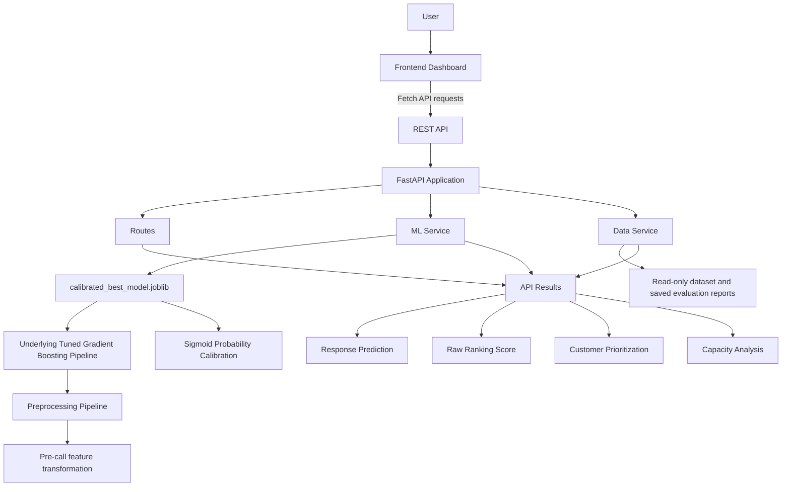
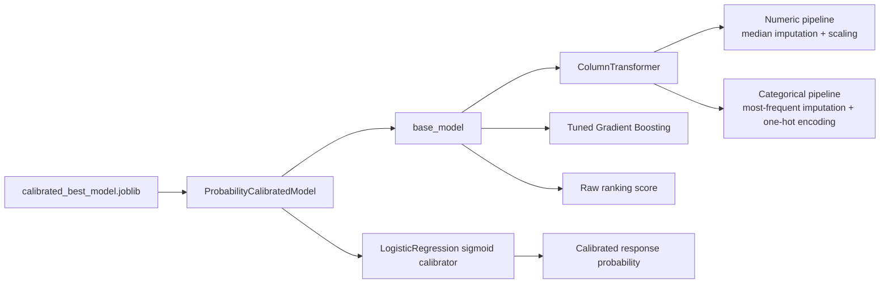

# System Architecture

This document describes the implemented Banking Campaign Response Prediction
and Contact Prioritization system. It reflects the current source code,
artifacts, API routes, and dashboard behavior.

## Component architecture



## Implemented components

### Frontend dashboard

The frontend is implemented with:

- `frontend/index.html`
- `frontend/css/styles.css`
- `frontend/js/api.js`
- `frontend/js/app.js`
- `frontend/js/charts.js`
- Chart.js loaded through a CDN

The dashboard provides overview statistics, single-customer prediction,
batch prioritization, and capacity analysis. The API base URL is configurable
and defaults to `http://127.0.0.1:8000/api`.

### FastAPI application

The application is implemented in `backend/main.py`. It:

- Creates the FastAPI application
- Loads `BankingModelService` and `ProjectDataService` during application startup
- Enables CORS for the future dashboard
- Registers the `/api` routes
- Provides structured Pydantic validation errors

### API routes

The implemented routes are:

| Route | Function |
|---|---|
| `GET /api/health` | Application and model status |
| `GET /api/summary` | Dataset and evaluation summary |
| `GET /api/model-info` | Features, metrics, and calibration metadata |
| `POST /api/predict` | Prediction for one future customer |
| `POST /api/prioritize` | Ranking for a future customer batch |
| `POST /api/capacity-analysis` | Top-K selection for a capacity percentage |

### Data service

`backend/data_service.py` reads the original dataset and saved reports to
provide summary and model-information responses. It does not modify the
dataset and does not expose historical outcomes in future-customer prediction
responses.

### ML service

`backend/ml_service.py` loads the calibrated model once. It explicitly keeps
two outputs separate:

1. The raw positive-class score from the underlying Gradient Boosting pipeline.
2. The sigmoid-calibrated positive-class probability from the calibration wrapper.

The raw score is used for customer ordering. The calibrated probability is used
for response probability, priority category, and expected responder estimates.

## Model artifact structure



The pre-call feature contract excludes `duration` and `y`. Future customers do
not have historical actual outcomes available, so API responses do not return
`actual_y` or any equivalent historical label.

## Result semantics

```text
Raw ranking score
    -> sort customers from highest to lowest
    -> priority rank

Raw ranking score
    -> sigmoid calibration
    -> calibrated response probability
    -> expected responders = sum of calibrated probabilities
```

Expected responders are statistical estimates, not guaranteed subscriptions.

