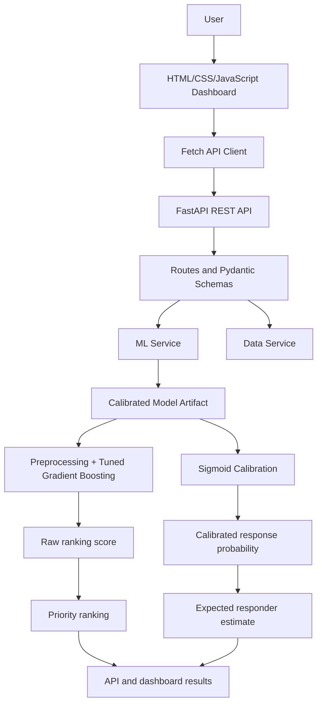
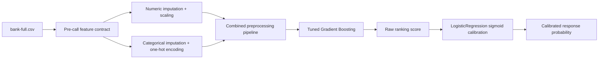
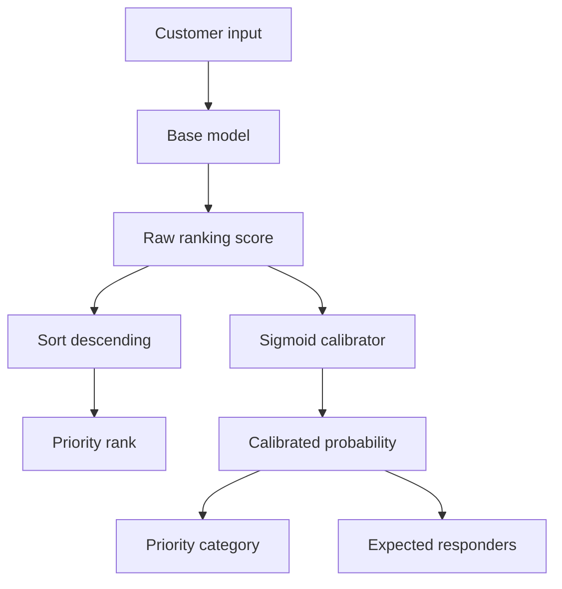
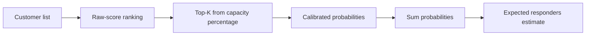
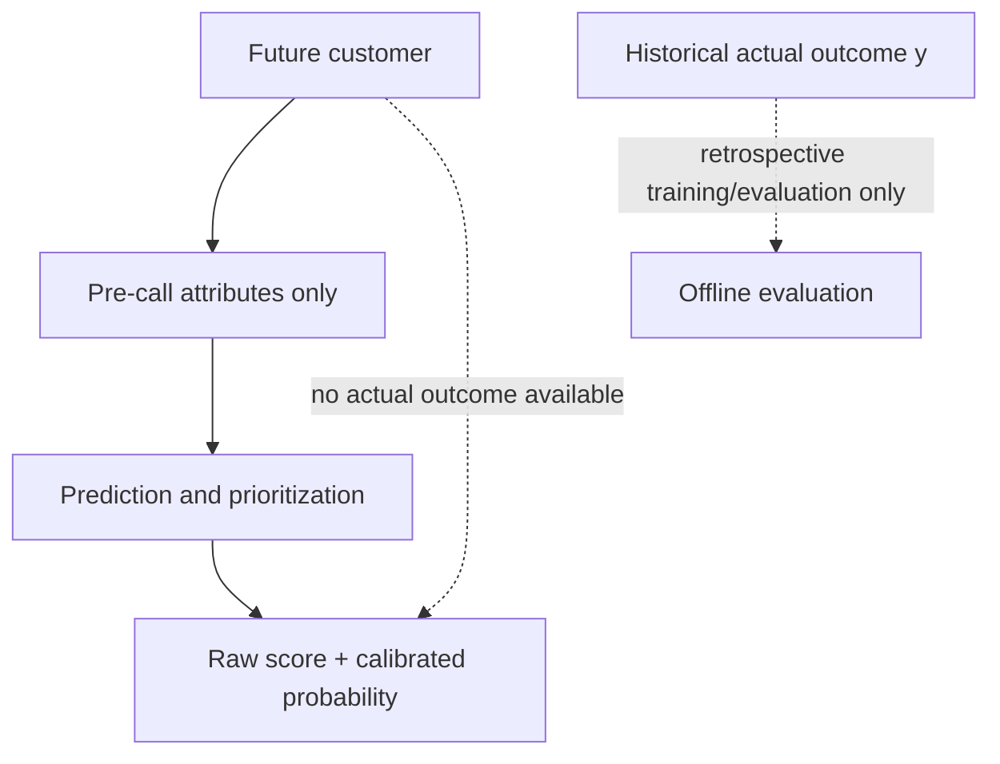

# Presentation Diagram Set

This page collects the concise Mermaid diagrams suitable for a college project
report or presentation. They describe implemented functionality only.

## 1. End-to-end system view



## 2. Model design



## 3. Prioritization and calibration distinction



The two paths are intentionally separate:

| Value | Implemented use |
|---|---|
| Raw ranking score | Customer ordering and Top-K selection |
| Calibrated probability | Response probability, priority category, and expected responders |

## 4. Capacity decision flow



The implemented Top-K rule is:

```text
K = floor(N × capacity_percentage / 100)
```

with 100% selecting all available customers. Small non-zero capacities select
at least one customer in the backend implementation.

## 5. Future-customer boundary



Actual outcomes are not available for future API requests. Expected responders
are model estimates, not guaranteed subscriptions.

