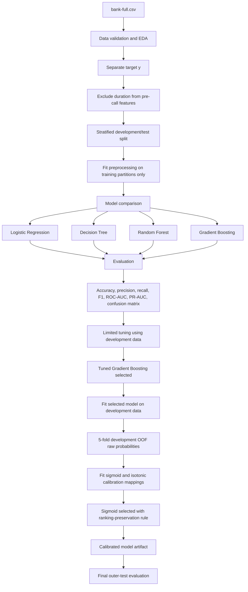
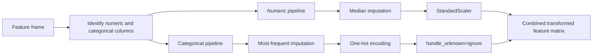
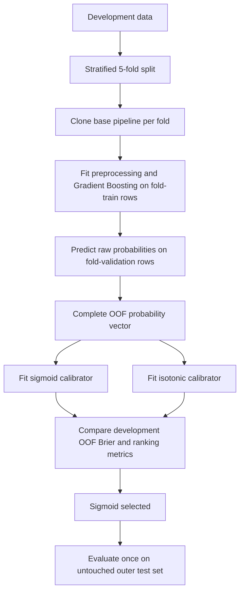
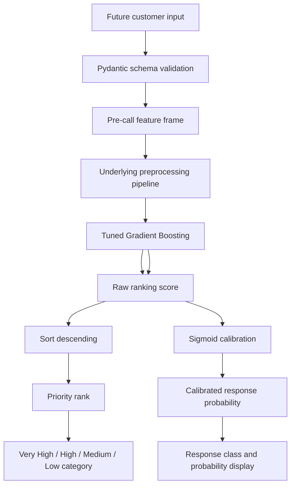

# Machine Learning and Application Workflow

This workflow documents the implemented path from `bank-full.csv` to the
dashboard and API results. It does not include deployment or public URL steps.

## Complete ML workflow



## Leakage controls

- `y` is kept strictly as the target.
- `duration` is excluded because it is observed after a campaign call.
- Preprocessing is fitted on training data, not on the full evaluation population.
- Hyperparameter tuning uses development data only.
- Calibration mappings use development-set out-of-fold raw probabilities.
- The outer test set is reserved for final evaluation.

## Preprocessing workflow



## Probability calibration workflow



The final calibrated model uses the positive-class probability from the
sigmoid calibrator. The wrapper does not use the calibrator's hard class label
as a probability.

## Customer prioritization workflow



The backend priority category is based on the calibrated probability using the
implemented thresholds:

- Very High: probability `>= 0.75`
- High: probability `>= 0.50`
- Medium: probability `>= 0.25`
- Low: probability `< 0.25`

The ordering itself uses the raw ranking score, not the category label.

## Capacity analysis workflow

```mermaid
flowchart TD
    A[Future customer list] --> B[Validate each customer]
    B --> C[Calculate raw ranking score]
    C --> D[Sort descending by raw score]
    D --> E[Calculate K from capacity percentage]
    E --> F[floor(N x capacity / 100)]
    F --> G[Select Top-K customers]
    G --> H[Read sigmoid-calibrated probabilities]
    H --> I[Average calibrated probability]
    H --> J[Sum calibrated probabilities]
    J --> K[Expected responders estimate]
```

At 100% capacity, all supplied customers are selected. For future customer
inputs, actual historical outcomes are unknown and are not returned by the API.

**Expected responders are estimates, not guaranteed subscriptions.**

